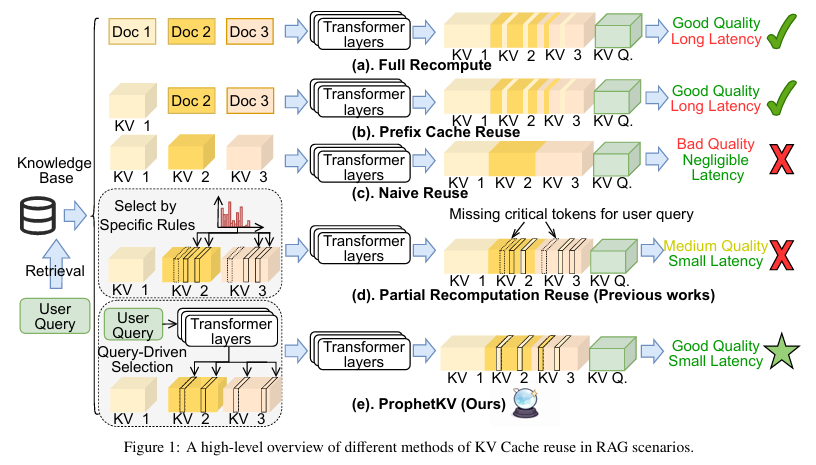
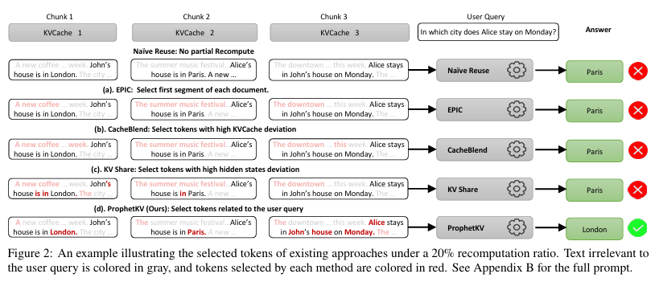
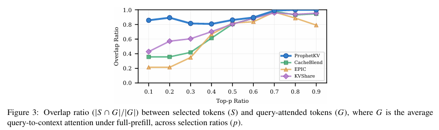
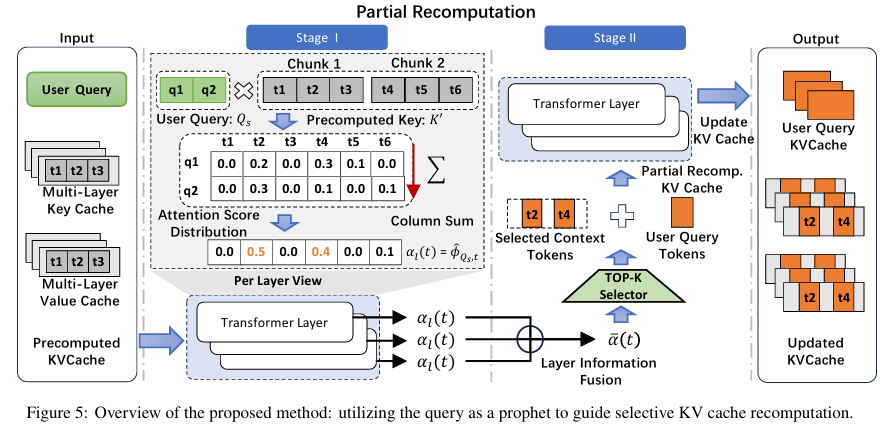
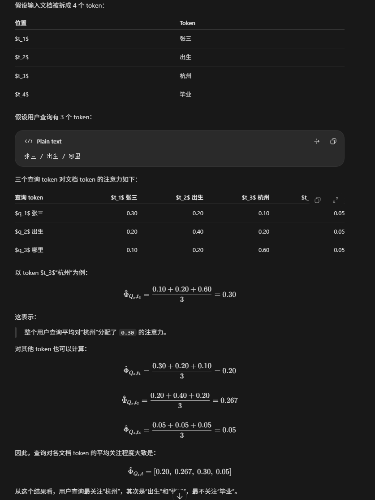
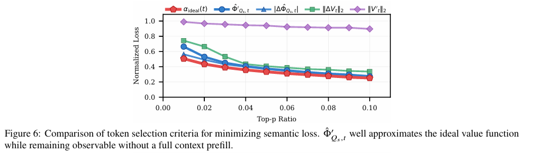
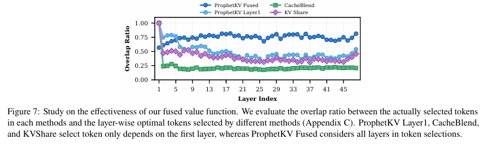
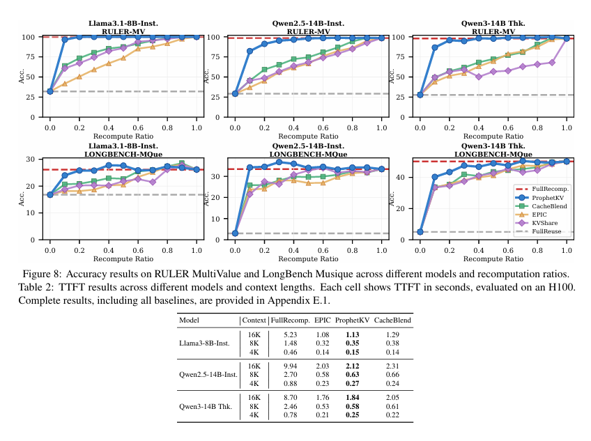
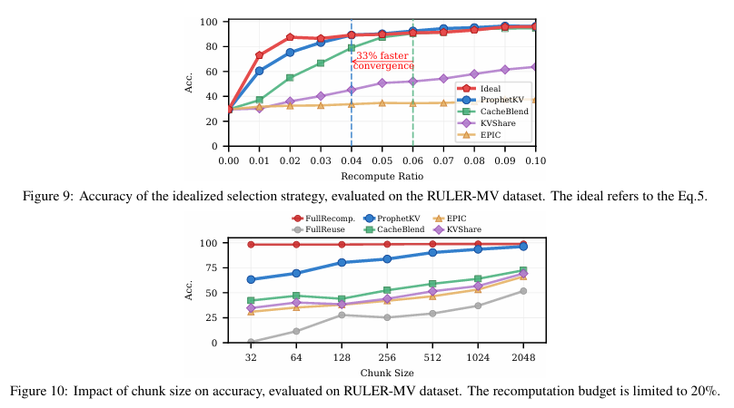

---
# ======== 区域划分 ========
# 稳定编号：用于链接和图谱关联，创建后保持不变
id: icml-2026-prophetkv
# 专题编号：对应 Paper/map.json 的 topic，双向同步
topics: [ "rag-prefill", "kv-cache" ]
# 方向编号：对应 map.json 的 direction.id，可多选
directions: [ "position-independent-kv-reuse", "rag-selective-recompute" ]
# 方向名称：根据 directions 自动生成
category: "位置无关 KV 复用；RAG 选择性重计算"

# ======== 文章详情 ========
# 简称用于列表和图谱，完整标题用于详细阅读
shortTitle: "ProphetKV"
title: "ProphetKV: User-Query-Driven Selective Recomputation for Efficient KV Cache Reuse in Retrieval-Augmented Generation"
venue: "ICML"
year: 2026
# 搜索标签：自由关键词，不参与图谱归属
tags: [ "RAG", "KV Cache", "Selective Recomputation", "Prefill" ]
# 作者按原文顺序填写
authors:
  - Shihao Wang
  - Jiahao Chen
  - Yanqi Pan
  - Hao Huang
  - Yichen Hao
  - Xiangyu Zou
  - Wen Xia
  - Chongyang Qiu
  - Wentao Zhang
  - Pengfei Wang
# 阅读状态：待阅读 / 已阅读 / 精读；优先级：P1 / P2 / P3
status: "精读"
priority: "P1"
# 简短摘要：用于检索和论文概览
summary: "针对 RAG 分块 KV 复用造成的跨文档注意力缺失，ProphetKV 用查询注意力选择性重算关键 token；所给 v3 预印本在 20% 重算预算下报告了接近 full-prefill 的基准准确率。"

# ======== 相关目录 ========
# 线上论文与代码链接，没有则留空
paperUrl: "https://proceedings.mlr.press/v306/wang26y.html"
codeUrl: ""
# 本地论文 PDF：相对项目根目录，仅本地预览可打开
localPdf: "Paper/papers/ICML_2026_ProphetKV.pdf"
# 本地 Markdown 笔记：文件自身的相对路径，构建时自动校正
localNote: "Paper/notes/RAG 预填充优化/ICML_2026_ProphetKV/ICML_2026_ProphetKV.md"
---

# 小结

### 核心创新

这是一篇面向长上下文 RAG 预填充阶段的 KV Cache 复用方法论文，重点不是压缩缓存字节数，而是在固定 token 重算预算内优先恢复与当前 query 有关的跨 chunk 信息。
### 研究问题与方法

逐 chunk 预计算 KV 可以避免每次对整段检索上下文重新 prefill，但拼接缓存会缺少文档间的交互。已有选择策略可能把预算用在全局显著、却与当前问题无关的 token 上。ProphetKV 先计算 query 对各层上下文 KV 的注意力，再融合层间得分并重算排名靠前的 token。

### 实验结果

论文在 RULER、LongBench、多种 8B/14B 模型和不同重算比例下评估质量，并在 H100 上报告 TTFT。作者报告 20% 重算预算下达到 full-prefill 准确率的 96%–101%，以及相对对照方法的准确率提升；8K/16K 场景的最高速度提升约 5×。


# 精读

## 精简摘要

长上下文检索增强生成（RAG）的**预填充阶段**受到计算开销的严重瓶颈。==背景==

近期方法通过检索到的RAG文档（基于用户查询）组装预先计算的KV缓存，并重新处理被选中的令牌，以恢复这些预先计算的KV缓存之间的交叉注意力。==现在的研究方法==

然而，我们发现在当前的令牌选择标准中存在一种根本性的“挤出效应”：全局显著但与用户查询无 关的token饱和了有限的重计算预算，挤占了真正对回答用户查询至关重要的 token，从而降低了推理准确性。 ==发现问题==

我们提出了 ProphetKV，一种面向RAG场景的用户查询驱动的KV缓存复用方法。ProphetKV 根据令牌与用户**查询的语义相关性**动态地对令牌进行优先级排序，并采用**双阶段重计算流水线**将逐层注意力指标融合为一个高可用集。 通过确保重计算预算用于弥合检索到的上下文与用户查询之间的信息差距==论文的方法==

ProphetKV 以最小的开销实现了高保真注意力恢复。结果表明，仅以 20% 的重计算比率即可保留全预填充准确率的 96%–101%。==效果提升==


## 研究背景

**预填充阶段**（处理提示词）在长上下文RAG场景中成为主要瓶颈。

* 传统方法依赖于严格的前缀匹配，这一要求在 **RAG 场景中很少得到满足**，因为在这些场景中，检索文档会被动态重新排序，且很少共享公共前缀。==传统的严格的匹配几乎不会满足==
* 检索到的块在多个请求间往往完全相同 ==使用场景很多==

简单地将独立预计算的KV缓存进行拼接会导致严重的精度下降，因为该方法忽略了**文档间的交叉注意力**。需要在计算开销节省与推断准确率之间取得平衡。 

**根本缺陷**：**选择标准**本质上是盲目的。

* 通过依赖**全局注意力权重**或**位置启发式方法**，这些方法试图近似标准 Transformer 预填充中的**完整交叉注意力映射**，但无法区分通用显著性和任务特定相关性。==现有方法==
  - **全局注意力权重**：把模型已有的注意力分数汇总起来，选分数高的 token。比如某些词经常受到模型关注，就被认为“重要”。这里的“全局”通常意味着分数来自多个注意力头、层或上下文的汇总，不一定针对当前用户问题。 
  - **位置启发式方法**：按 token 所在位置挑选，不细看语义。例如优先保留开头、最近的内容，或者按固定间隔抽取一部分 token。
* 在检索文档中，**仅有一小部分关键句子对任务至关重要**，而其余大量内容对特定的用户查询而言在语义上是无关的。对这些“未使用”token 进行重建交叉注意力，对最终答案生成的效用微乎其微，却会产生可观的重计算成本。==现有方法不合理的根本原因==
* 这导致了“crowding-outeffect”：有限的重计算**预算被全局活跃但与任务无关的 token 所占据**，从而排挤了对准确答案生成真正至关重要的 token。

**对现有方法的批评**：如果一种轻量级机制能够忠实地恢复完整的交叉注意力语义，它将取代标准Transformer注意力，因为预计算和重建的总成本将显著低于完整预填充成本

* 质疑“**预算有限时，尽量恢复所有缺失的注意力关系**”这个目标，现有方法实际是在准确率和速度之间折中  


**发现的问题**：

1. 先前方法采用的重建目标**对于检索增强生成任务在功能上是冗余**的； --为了完成当前问答任务，不必把所有关系都还原
2. 交叉注意力的效用严格依赖于查询的。在检索增强生成场景中，**用户查询作为一个决定性的语义先验**，定义了令牌的相关性。  --一个 token 有多大用处，要看用户问了什么


## 研究问题

- 问题：如何复用分块预计算的 KV，同时减少拼接缓存缺失跨文档注意力所带来的生成质量下降？
- 约束：完整 prefill 的代价高；部分重算预算有限；token 重要性随 Transformer 层变化。
- 研究问题：能否在不运行完整上下文 prefill 的情况下，低成本估计 query 相关的重算优先级？


## 核心创新

ProphetKV 以 query 对检索上下文 KV 的注意力作为 token 价值代理，跨层融合后选择性重算，使有限重算预算更多用于恢复回答当前 query 所需的跨 chunk 交互。



ProphetKV 促进了从**盲目近似全局注意力分布**到**查询定向注意力恢复**的范式转变，确保部分重计算机制专门用于修复与特定查询相关的交叉注意力。

ProphetKV 通过**两个协同组件**优化准确率与效率之间的权衡：

1. **用户查询引导的令牌选择**：我们引入了一种机制，利用用户查询的注意力权重来动态隔离对用户查询具有语义关键性的上下文令牌。
2. **带层融合的双阶段重计算**：重要 token 可能随 Transformer 层变化：某个 token 在一层不突出，在另一层却很关键。ProphetKV 会综合不同层的注意力相关指标，以**推导出统一的、高实用性的重计算集合**，避免只看某一层而漏选关键内容。
   * **逐层评估相关性**：在每个 Transformer 层，计算用户查询对文档各 token 的注意力，得到每个 token 在该层的重要性分数。
   * **融合各层分数，再选择重算对象**：不同层关注的 token 可能不一样。ProphetKV 把各层分数汇总，选出总体最重要的一批 token，然后只重新计算这些 token 的 KV；其余 token 继续复用已有缓存。

**对应的效果对比：**



**和其他现有方法的对比：**



**核心是：旧方法挑错了要重算的词，所以即使重算了一部分，也可能没修复回答问题所需的关键信息。**

**Alice 的例子**  
问题是：“Alice 星期一住在哪个城市？”论文说，回答需要把块 1 和块 3 的信息联系起来，而块 2 含有误导信息。由于文档块原先各自计算缓存，块之间的联系没有充分建立。若重算时漏掉块 1、块 3 中承载关键联系的词，模型就可能被块 2 的干扰带偏，答成 “Paris”。

**图 3 **  

- 横轴 `Top-p 比率`：重算预算，也就是选了多少比例的 token。
- `S`：方法实际选来重算的 token。
- `G`：作为参考，完整预填充时用户查询会关注的上下文 token。
- 纵轴是 `|S ∩ G| / |G|`：查询关注的 token 中，有多少被这个方法选中了。它类似“关键 token 的覆盖率”，**不是答案准确率本身**。

当预算很小时，例如 `p=0.1`，ProphetKV 覆盖了大约 85% 的参考 token，而几种旧方法覆盖得少得多。预算增加后，各方法都能选中更多参考 token，曲线也逐渐接近。 -- **预算有限时，按当前查询挑选，比不看查询、盲目挑选更容易把预算花在相关内容上。**

* EPIC 使用固定的位置启发式；
* CacheBlend 和 KVShare 使用偏差指标，并借助较低层的信息估计高层的重要性。但某些 token 的语义相关性可能到深层才显现，因此低层指标可能没把它们挑出来。


## 具体创新

### 概述

**怎么实现：不要把所有缺失的信息交互都恢复，而要优先修复与用户问题有关的部分** ，**解决“怎么选、按哪层选”**

* 如何便宜地给 token 打分
* 不同层意见不一致时该听谁的

**双阶段框架：先评估，再重计算**

* 第一阶段根据用户问题评估文档 token 的重要性 ==决定把计算预算花在哪里==
* 第二阶段按照评分选择一部分 token 重计算，其余 token 继续使用缓存。==真正执行修复==



**整个流程：**

1. **Stage I，评分**：计算每层中问题 token 对文档 token 的注意力，并按文档 token 汇总。
2. **融合层信息**：不同层关注的内容不同，把各层分数融合成统一评分。
3. **Top-K 选择**：按评分挑出预算允许重算的 token。
4. **Stage II，重算**：对选中的 token 做跨层重计算，更新 KV 缓存；其他 token 继续复用旧缓存。


### 挑战一：怎么把“问题关注什么”变成一个便宜、可靠的分数？

**预算只够重算一部分 token 时，怎样判断哪些 token 最值得重算？**

- **评分要有用**：分数应该尽量反映 token 对当前问题的重要性，而不是文档中一般意义上的显著程度。
- **评分要便宜**：不能为了挑出少数需要重算的 token，先把整个上下文完整重算一遍，否则加速的意义就没有了。

ProphetKV 的做法是**先用用户问题给文档 token 打分，再挑高分 token 重算。**

**针对挑战1，形式化了查询注意力与生成输出保真度之间的关系，弥合了直觉与数学严谨性之间的差距。**


#### 定义数值损失函数

**1. 定义处理范围：**==简单说明本论文只做 prefill 阶段==

**注意力输出**：注意力模块会把它关注的 token 的值向量加权求和：$$ \mathrm{AttnOut}_n = \sum_{t\le n}\Phi_{n,t}V_t $$

- $\Phi_{n,t}$：位置 $n$ 对位置 $t$ 的注意力权重（softmax 归一化后）；
- $V_t$：token $t$ 携带的信息；
- $\Phi_{n,t}V_t$：token $t$ 对当前位置输出的贡献。

当 $n$ 是正在生成的答案 token 时，输入文档的 KV 缓存会影响答案。这里只研究输入 token 的贡献，不考虑之前已生成的答案 token 的贡献。

**例子：**假设输入一共 6 个 token，之后模型生成了 3 个答案 toke

```
位置 1-6：输入（问题 + 文档）
位置 7-9：已经生成的答案
```

现在看模型处理第 9 个 token 时，注意力输出由两部分组成：一部分来自原始输入，另一部分来自之前生成的答案 token。

$$\mathrm{AttnOut}_9
=
\underbrace{\sum_{t=1}^{6}\Phi_{9,t}V_t}_{\text{原始输入的贡献}}
+
\underbrace{\sum_{t=7}^{9}\Phi_{9,t}V_t}_{\text{生成 token 的贡献}}$$

假设输入是“问题：张三出生在哪里？”加上文档“张三出生于杭州，毕业于某大学”，那么模型处理答案中的“杭州”时：

- 第一部分会从问题和文档中取信息，例如“出生在哪里”“出生于杭州”。这部分依赖输入 token 的 KV 缓存。
- 第二部分会从已经生成的答案中取信息，例如刚生成的“张三出生于”。这部分依赖生成 token 的表示。

论文关注第一部分==prefill==，解决的问题是：**分块预计算产生的输入 KV 缓存不够准确，怎样挑出重要输入 token 来重算？** 已生成答案 token 的贡献不是这里要修复的对象。

* 如果分块缓存里“杭州”对应的 $ V_t $ 不准确，那么第一项就可能提供错误信息。ProphetKV 会尝试根据问题的注意力，判断“杭州”等哪些输入 token 值得重新计算。


**2. 位置无关 KV 缓存会造成多大的信息误差？** ==定义误差，类似损失函数 -- 整体的误差有多大==

**计算整体语义损失**：

在完整预填充中，输入 token 对注意力输出的贡献是 $$ \sum_{1\le t\le s}\hat{\Phi}_{Q_s,t}V_t $$

在位置无关的 KV 复用中，文档被分开计算，得到的是近似结果：$$ \sum_{1\le t\le s}\hat{\Phi}'_{Q_s,t}V'_t $$

因此，两者之间的差异定义为语义损失：$$ L_{\mathrm{semantic}} = \left\| \sum_{1\le t\le s}\hat{\Phi}_{Q_s,t}V_t - \sum_{1\le t\le s}\hat{\Phi}'_{Q_s,t}V'_t \right\|_2 $$

其中：

- $V_t$：完整计算时，token t 的正确值向量；
- $V'_t$：KV 复用时，token t 的近似值向量；
- $\hat{\Phi}_{Q_s,t}$：完整计算时，查询对 token t 的平均注意力；
- $\hat{\Phi}'_{Q_s,t}$：KV 复用时，查询对 token t 的近似注意力。

> 第一项是“完整 Transformer 应该得到的信息”，第二项是“KV 复用实际得到的信息”，两者的差是缓存造成的语义损失，它是判断答案质量损失的一个代理指标。

**$$ \hat{\Phi}_{Q_s,t} $$ 含义：**

 

**具体的数值例子**

假设只有两个输入 token，value 向量简化为二维向量，完整计算结果：

$$ \hat{\Phi}_{Q_s,1}=0.4, \qquad V_1= \begin{bmatrix} 1\\ 0 \end{bmatrix} $$

$$ \hat{\Phi}_{Q_s,2}=0.6, \qquad V_2= \begin{bmatrix} 0\\ 1 \end{bmatrix} $$

因此，完整计算产生的输入贡献为：$$ 0.4 \begin{bmatrix} 1\\ 0 \end{bmatrix} + 0.6 \begin{bmatrix} 0\\ 1 \end{bmatrix} = \begin{bmatrix} 0.4\\ 0.6 \end{bmatrix} $$

KV 复用结果：

$$ \hat{\Phi}'_{Q_s,1}=0.3, \qquad V'_1= \begin{bmatrix} 0.9\\ 0.1 \end{bmatrix}  $$

$$\hat{\Phi}'_{Q_s,2}=0.5, \qquad V'_2= \begin{bmatrix} 0.2\\ 0.7 \end{bmatrix} $$

KV 复用产生的输入贡献为：$$ 0.3 \begin{bmatrix} 0.9\\ 0.1 \end{bmatrix} + 0.5 \begin{bmatrix} 0.2\\ 0.7 \end{bmatrix} = \begin{bmatrix} 0.37\\ 0.38 \end{bmatrix} $$

所以整体误差为：$$ L_{\mathrm{semantic}} = \left\| \begin{bmatrix} 0.4\\ 0.6 \end{bmatrix} - \begin{bmatrix} 0.37\\ 0.38 \end{bmatrix} \right\|_2= 0.2220$$

这表示：**KV 复用得到的输入信息与完整计算结果存在一定差异。**


**3. 怎样把整体误差拆成每个 token 的误差，从而决定先重算谁？** ==整体误差拆成 token 误差 -- 哪些 token 是误差的主要来源== 

论文把每个 token 的贡献单独拿出来比较：$$ L = \sum_{1\le t\le s} \left\| \hat{\Phi}'_{Q_s,t}V'_t - \hat{\Phi}_{Q_s,t}V_t \right\|_2$$

并认为：$$ L_{\mathrm{semantic}}\le L $$    -- 利用三角不等式推导

其中，每个 token 的局部误差为：$$ \left\| \hat{\Phi}'_{Q_s,t}V'_t - \hat{\Phi}_{Q_s,t}V_t \right\|_2 $$

这个量表示：token t 在 KV 复用中产生的近似贡献，与完整计算中本应产生的贡献，相差多少。


**继续上述例子**

对于 token 1，完整贡献为：$$ \hat{\Phi}_{Q_s,1}V_1 = \begin{bmatrix} 0.4\\ 0 \end{bmatrix} $$

复用贡献为：$$ \hat{\Phi}'_{Q_s,1}V'_1 = \begin{bmatrix} 0.27\\ 0.03 \end{bmatrix} $$

所以 token 1 的误差为：$$ \left\| \begin{bmatrix} 0.27\\ 0.03 \end{bmatrix} - \begin{bmatrix} 0.4\\ 0 \end{bmatrix} \right\|_2 = 0.1334 $$

对于 token 2，完整贡献为：$$ \hat{\Phi}_{Q_s,2}V_2 = \begin{bmatrix} 0\\ 0.6 \end{bmatrix} $$

复用贡献为：$$ \hat{\Phi}'_{Q_s,2}V'_2 = \begin{bmatrix} 0.1\\ 0.35 \end{bmatrix} $$

所以 token 2 的误差为：$$ \left\| \begin{bmatrix} 0.1\\ 0.35 \end{bmatrix} - \begin{bmatrix} 0\\ 0.6 \end{bmatrix} \right\|_2 = 0.2693 $$

于是：$ L=0.1334+0.2693=0.4027 $

可以看到，**token 2 的局部误差更大。因此，如果只能重算一个 token，应该优先重算 token 2。**

> 这里公式中的正确值 $V_t$ 和正确注意力 $\hat{\Phi}_{Q_s,t}$，仍然需要完整计算才能得到。因此它只是一个**理想的选择依据**，实际执行前无法直接计算。
> ProphetKV 后面才进一步用可以提前观测的：$$ \alpha(t)=\hat{\Phi}'_{Q_s,t} $$ 来近似这个理想误差。


#### **推导理想值和实用值函数**

**4. 假设：被选中的 token 一旦重算，就可以近似恢复为正确的 KV 缓存。** ==未选中的 Token 的计算误差尽可能小==

剩下没有被重算的 token，仍然会产生误差，重算比例为 `p` 时，剩余损失定义为：

$$ L_{\alpha,p} = \sum_{t\notin \mathrm{TOP}_p(\alpha(t))} \left\| \hat{\Phi}'_{Q_s,t}V'_t - \hat{\Phi}_{Q_s,t}V_t \right\|_2$$

这里：

- $\alpha(t)$：给 token t 的重要性评分；
- $\mathrm{TOP}_p(\alpha(t))$：按照评分从高到低选择前 p 比例的 token；
- $p$：重算预算比例；
- 求和范围：没有被选中、仍然使用旧缓存的 token。

例如：

- `p=0.1`：只能重算 10% 的 token；

* 选择得好，重要 token 被重算，剩下 token 的误差就小，$L_{\alpha,p}$ 就低。

* 选择得不好，真正重要的 token 没被重算，$L_{\alpha,p} $ 就会很高。

论文的目标是：$ \min_{\alpha} L_{\alpha,p} $  -- **设计一个好的评分函数 $\alpha(t)$，让有限的重算预算尽可能降低剩余损失。**


**5. 理想重要性评分** 

每个 token 的局部误差可以写成：$ \alpha_{\mathrm{ideal}}(t) = \left\| \hat{\Phi}_{Q_s,t}V_t - \hat{\Phi}'_{Q_s,t}V'_t \right\|_2$

这个分数的含义是：token t 使用错误 KV 缓存时，和正确 KV 缓存相比，造成了多大注意力贡献误差。

因此：

- 分数高：这个 token 对整体误差影响大，应该优先重算；
- 分数低：这个 token 对整体误差影响小，可以暂时继续使用旧缓存。


**6. 理想的重要性分数由哪些因素决定，以及为什么最后选择查询注意力作为实际评分** ==根据理论公式反推误差的来源==

**论文定义：**

$ \Delta\hat{\Phi}_{Q_s,t} = \hat{\Phi}_{Q_s,t} - \hat{\Phi}'_{Q_s,t} $

$ \Delta V_t = V_t-V'_t $

**因此：**

$ \hat{\Phi}_{Q_s,t} = \hat{\Phi}'_{Q_s,t} + \Delta\hat{\Phi}_{Q_s,t}    $

$V_t=V'_t+\Delta V_t $

**将它们代入理想评分：**

$ \begin{aligned} \alpha_{\mathrm{ideal}}(t) &= \left\| \hat{\Phi}_{Q_s,t}V_t - \hat{\Phi}'_{Q_s,t}V'_t \right\|_2 \\ &= \left\| \Delta\hat{\Phi}_{Q_s,t}V'_t + \left( \hat{\Phi}'_{Q_s,t} + \Delta\hat{\Phi}_{Q_s,t} \right)\Delta V_t \right\|_2 \end{aligned} $

把原来的误差拆成两部分：$ \text{总误差} = \text{注意力变化造成的误差} + \text{Value 表示变化造成的误差} $


#### 误差来源和影响因素

**1. 两个误差来源**

**第一部分：注意力权重发生变化**

$ \Delta\hat{\Phi}_{Q_s,t}V'_t $

**表示：**KV 复用前后，查询对 token t 的关注程度发生了变化。

如果注意力变化很大，且旧的 value 向量幅度也很大，那么这个 token 的贡献误差就可能很大。


**第二部分：Value 向量发生变化**

$ \left( \hat{\Phi}'_{Q_s,t} + \Delta\hat{\Phi}_{Q_s,t} \right)\Delta V_t $

由于：$ \hat{\Phi}'_{Q_s,t} + \Delta\hat{\Phi}_{Q_s,t} = \hat{\Phi}_{Q_s,t} $，所以第二部分也可以写成：$ \hat{\Phi}_{Q_s,t}\Delta V_t $

**表示：**token 的 Value 表示因为缺少**跨文档注意力**而发生变化，并由注意力权重放大或缩小。


**2. 四个影响因素**

**因素一：注意力变化幅度**

$ \left|\Delta\hat{\Phi}_{Q_s,t}\right| $

表示完整计算和 KV 复用之间，查询对 token $t$ 的关注程度变化了多少。

越大说明这个 token 的注意力模式受跨文档信息影响越明显。

**因素二：旧 Value 向量的大小**

$ \left\|V'_t\right\|_2 $

表示旧缓存中 token $t$ 携带的信息量大小。

但它只表示“信息向量大不大”，不表示“对当前问题重不重要”。因此单独使用它效果较差。==根据含义去理解的话==

**因素三：近似注意力权重**

$ \hat{\Phi}'_{Q_s,t} $

表示在当前不精确 KV 缓存下，用户查询已经关注 token $t$ 的程度。

这个因素很重要，因为它直接反映了：当前问题是否在使用这个 token。

**因素四：Value 向量的变化幅度**

$ \left\|\Delta V_t\right\|_2 $

表示重算前后，token $t$ 的 Value 表示改变了多少。

变化越大，说明旧缓存越不准确。


#### 最后实际使用

**为什么最后不用理想误差，而使用查询注意力？**

理想评分需要知道 $ \left|\Delta\hat{\Phi}_{Q_s,t}\right| $，以及 $ \left\|\Delta V_t\right\|_2 $

* 但这两个量需要先完成完整重计算才能得到，也就是说：想知道哪些 token 最值得重算，必须先把它们重算；但如果已经全部重算，就不需要再做 token 选择了。

相比之下，下面这个量可以在重算之前，通过轻量计算得到：$ \hat{\Phi}'_{Q_s,t} $

因此，ProphetKV 最终采用：$ \alpha(t)=\hat{\Phi}'_{Q_s,t} $

**它的含义是：先选择当前用户查询已经高度关注的 token，再对这些 token 做完整重计算。**


**简单例子**

假设有两个 token：

| Token | 查询对旧缓存的注意力 | 重算后注意力变化 | Value 变化 |
| ----- | -------------------- | ---------------- | ---------- |
| $t_1$ | 0.8                  | 未知             | 未知       |
| $t_2$ | 0.1                  | 未知             | 未知       |

在重算之前，我们不知道哪个 token 的真实误差更大。但是可以知道：

- 查询明显关注 $t_1$；
- 查询几乎不关注 $t_2$。

因此，ProphetKV 会优先重算 $t_1$，但这并不意味着 $t_1$ 的真实误差一定最大 ==可能是和之前工作的最大区别==，而是因为：

1. 用户问题已经关注它；
2. 它更可能参与最终答案；
3. 即使它有缓存误差，也更可能影响答案；
4. 这个信号可以低成本提前得到。


**比较不同的评分方式：**



图 6 比较了不同 token 评分方式。纵轴的残差损失越低，说明按该评分挑选 token 后剩下的误差越小。理想评分表现最好；在实际可用的候选信号中，问题对旧缓存的注意力 $\Phi'_{Q_s,t}$ 表现较好，因此被用作实用标准。

**图 6 得出的结论**

作者通过实验比较了不同评分方式。结果大致是：

$ \left|\Delta\hat{\Phi}_{Q_s,t}\right| > \hat{\Phi}'_{Q_s,t} > \left\|\Delta V_t\right\|_2 > \left\|V'_t\right\|_2 $

也就是说：

1. 用真实注意力变化量评分最好，但重算前不知道；
2. 用查询对旧缓存的注意力评分效果次好，而且提前可计算；
3. Value 变化量有效，但重算前不知道；
4. 仅用 Value 向量大小效果较差。

所以最终选择：$ \alpha(t)=\hat{\Phi}'_{Q_s,t} $


**具体例子**

假设用户问题是：

```
张三出生在哪里？
```

查询 token 集合为： $Q_s=\{\text{张三},\text{出生},\text{哪里}\} $

检索到的文档被拆成 6 个 token：

| Token | 内容 |
| ----- | ---- |
| $t_1$ | 张三 |
| $t_2$ | 出生 |
| $t_3$ | 于   |
| $t_4$ | 杭州 |
| $t_5$ | 毕业 |
| $t_6$ | 大学 |

ProphetKV 不会先把这 6 个文档 token 全部完整重算，而是让查询 token 去查看已有缓存。

**打分时：文档 KV 直接复用**，只让**问题 token**经过 Transformer，计算问题对文档的注意力：

$ A'=\operatorname{softmax} \left( \frac{ Q_{\text{问题}}\,(K'_{\text{文档}})^\top }{\sqrt d} \right) $


### 挑战二：不同层关注的 token 不一样，到底按哪一层来选？

**不同层对“谁重要”的判断不一致，怎样综合这些判断，选出一批在整个模型计算过程中都比较有用的 token？**


#### **什么是“选择死锁”？**

想知道文档中哪些 token 最重要，就要算出每一层的 KV，通常就得让整篇文档经过模型的各层 ==一遍完整预填充==。相当于：**为了挑选少量 token，先把所有 token 都完整计算了，挑选也就失去了省计算的作用。** 作者把这种“要先完成全部计算，才能决定哪些计算值得做”的困境称为计算死锁。


#### **ProphetKV 怎样避免完整计算文档？**

ProphetKV 不先计算所有文档 token 在当前层的新表示，而是直接使用已经存在的近似缓存：$ K_t'^{(l)},\quad V_t'^{(l)} $，这些缓存是文档预先独立计算得到的。

然后，只**让用户查询 token 参与当前层的注意力计算**。对于第 l 层中的查询 token q 和文档 token t，计算：

$ \Phi_{q,t}'^{(l)} = \operatorname{softmax}_t \left( \frac{\mathbf{q}_q^{(l)} \left(\mathbf{k}_t'^{(l)}\right)^{\mathsf T}} {\sqrt{d}} \right) $

其中：

- $\mathbf{q}_q^{(l)}$：第 l 层中用户查询 token q 的 Query 表示；
- $\mathbf{k}_t'^{(l)}$：已有缓存中，文档 token t 的近似 Key；
- $\Phi_{q,t}'^{(l)}$：查询 token q 对文档 token t 的注意力权重。

重点是：它**只计算“查询 token → 文档 token”的注意力，而不计算“所有文档 token → 所有文档 token”的完整注意力**。 ==问题 token 远少于文档 token，所以很省==

完整注意力的成本大约是：$ O(s^2) $

只计算查询到文档的注意力，成本大约是：$ O(|Q_s|\times s) $

因为通常： $|Q_s|\ll s $，所以这个过程便宜得多。


#### ProphetKV 怎样绕开死锁？

使用上面的实用评分：**查询对文档 token 的注意力**。在每一层，模型可以用查询 token 的表示，去查看已有的文档 KV 缓存，并得到该层的注意力评分；不需要先对所有文档 token 做完整的跨层重计算。

对文档 token t，第 l 层的评分记为 $\alpha_l(t)$。

图 5 中，它来自查询 token 到该文档 token 的注意力权重汇总。然后将各层评分取平均，得到一个全局评分：$$\bar{\alpha}(t)=\frac{1}{L}\sum_{l=1}^{L}\alpha_l(t)$$

这里 L 是 Transformer 的层数，平均为了避免只听某一层的判断：不同层可能关注不同 token，融合后再统一排序。

注意力权重在每层内归一化，因此作者认为这些分数有较一致的尺度，适合直接融合。 ==每一层单独计算 然后加和取平均来取 top_k==


**为什么要融合不同层的评分？**



**图说明：第 1 层认为重要的 token，不一定在后面的层中仍然重要。**

- **横轴**：Transformer 的层编号。
- **纵轴**：实际选中的 token 集合，与该层参考 token 集合的重叠率。越高，说明固定名单越符合该层的判断。
  - **浅蓝线 ProphetKV Layer1**：只根据第 1 层的查询注意力选 token，随着层数增加，覆盖效果下降。
  - **深蓝线 ProphetKV Fused**：综合所有层再选 token，在中深层仍保持较高重叠率。
  - **绿色和紫色曲线**：CacheBlend、KVShare 在这里使用首层信息近似后续层，实际选择与深层参考集合的重叠较低。

### 创新小结

##### 两阶段流程

1. **轻量级评分**：逐层计算查询 token 对已有文档 KV 缓存的注意力，汇总成每个文档 token 的分数。
2. **选择并重算**：融合各层分数，选出排名靠前的 k 个 token，再对被选中的 token 做跨层重计算，更新它们的 KV 缓存。

主要是避免让整篇文档都进行完整重计算：**先用查询和已有缓存低成本打分，再把完整计算集中给少数高分 token。**


## 实验设计

### 实验设置

**实验主要验证：相同重算预算下，能否更准确地选中关键 token，并获得实际加速。**

| 项目     | 设置                                                         |
| -------- | ------------------------------------------------------------ |
| 模型     | Llama-3.1-8B-Instruct、Qwen2.5-14B-Instruct、Qwen3-14B       |
| 数据集   | RULER：检索密集型任务；LongBench：长文本问答、推理、摘要等任务 |
| 对比方法 | 完整重算、EPIC、CacheBlend、KVShare                          |
| 默认配置 | 文档按 512 token 分块，主要比较 20% token 重算预算           |
| 效率指标 | TTFT，即从请求开始到生成首个 token 的时间                    |

各方法统一使用 Hugging Face Transformers 实现，以减少不同专用算子带来的干扰；主要 TTFT 对照在 H100 上测量。

### 实验结果



#### **准确率：相同预算下，选择是否更有效？**

**作者总体报告：同样只重算 20%，ProphetKV 更接近完整计算结果。**优势在需要从干扰信息中定位关键内容的任务上尤其明显。==有限预算下，选对 token 比单纯重算一批 token 更重要== 

#### 效率：评分的额外开销会不会抵消收益？

**额外评分存在，但在长上下文中仍能获得明显加速。**例如，H100 上 Qwen2.5-14B 的 16K 输入，完整重算 TTFT 为 **9.94 秒**，ProphetKV 为 **2.12 秒**，约加速 **4.7 倍**；EPIC 为 2.03 秒，说明 ProphetKV 并非延迟最低，但能**以接近的延迟提供更好的质量。**

#### 消融实验

- **层融合，图 7**：融合所有层后，与各层参考集合的重叠率明显高于只使用首层。==证明只看首层会遗漏后续层的重要 token==
- **重算比例，图 8**：在所测代表性任务中，ProphetKV 用约 **10%–30%** 重算即可将准确率下降控制在 5% 以内，旧方法通常需要 **40%–80%**。==查询引导使准确率恢复更快== 
- **理想化选择，图 9**：理想评分约在 2% 重算时收敛，ProphetKV 约 4%，CacheBlend 约 6%。实验提前收集了完整计算提供的参考信息，用于隔离选择策略的影响，**不能理解为真实运行时重算 4% 就普遍足够**。
- **分块大小，图 10**：chunk 越小，各方法准确率通常越低，因为缺失的跨块交互更多；ProphetKV 在所测分块设置下表现较好，大于 512 token 的分块中接近无损。



**图 9：谁能用更少的重算恢复得分？**

- **横轴**：重算的 token 比例，`0.04` 就是重算 4%。
- **纵轴 Acc.**：RULER-MV 任务上的答案得分。
- 曲线越快上升，说明选择越有效：**重算较少的 token，就能恢复较高得分。**

这里的 **“快 33%”**，可以理解为达到相近得分时，所需重算比例从 6% 减少到 4%：$$ \frac{6\%-4\%}{6\%}\approx33\% $$

**图 10：为什么文档块越大，得分通常越高？**

这里固定**重算预算为 20%**，只改变每个文档块的大小：

- 横轴：每块包含多少 token，例如 32、512、2048。
- 纵轴：答案得分。

> 小块留下的缺失交互更多，修复更困难；大块预计算得更充分，少量重算就更容易接近完整计算。


## 结论

**ProphetKV 的核心贡献，是把用户查询作为重算决策依据，让有限预算优先用于修复回答当前问题所需的信息交互。**

查询注意力解决“选谁”，跨层融合解决“综合哪些层的判断”，双阶段流程则实现“先低成本评分，再集中重算”。

实验支持：在所测模型和任务中，这种组合能以少量重算获得接近完整预填充的质量，同时降低长上下文的首 token 延迟。


# 草稿


